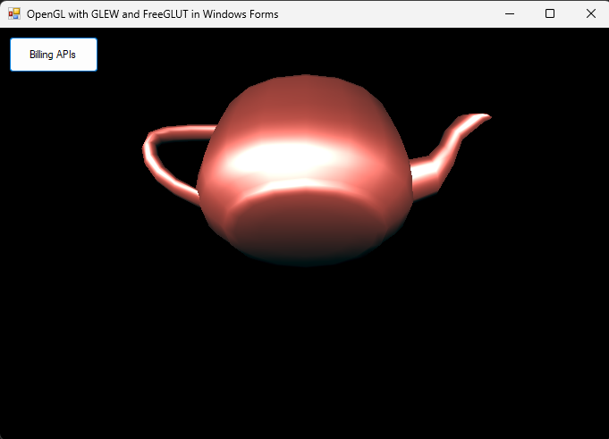
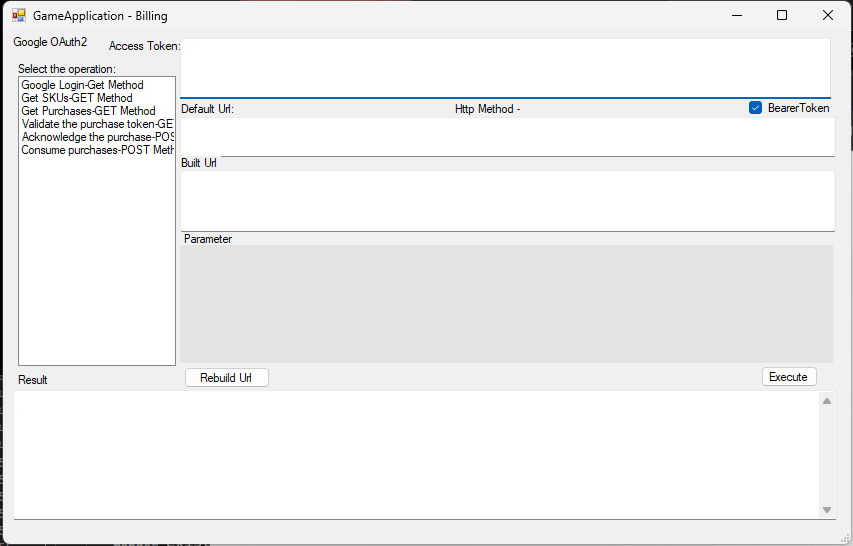

# Legacy REST API Sample (`api-client`) — Migration Reference Only

> **Deprecation & Migration Notice**: Do **not** use this REST-based OAuth2 implementation for new Google Play Games on PC titles. This sample is preserved specifically so developers migrating from the legacy REST flow (`Billing APIs`) can compare it side-by-side against the modern IPC-based **[`sdk-client/`](../sdk-client/)** (`Billing SDK`, Play Games PC SDK `26.9.261.0+`).

---

## Side-by-Side Migration Guide (`api-client` $\rightarrow$ `sdk-client`)

| # | Legacy `api-client` ("Billing APIs") | Modern `sdk-client` ("Billing SDK" `26.9.261.0+`) | What You Delete When Migrating |
| :- | :--- | :--- | :--- |
| **1** | `0 - Google Login` (Browser OAuth2 + per-login ephemeral `127.0.0.1` loopback listener + PKCE `S256` token exchange) | `1 - Initialize Billing SDK` (`GooglePlayInitialize` + `BillingClient`) | Delete all OAuth2 client IDs, env secrets, browser redirects, and local loopback TCP listeners. |
| **2** | `1 - Get SKUs` (`POST /api/getSkuDetails` + `https://play.google.com` checkout deep-link) | `2 - Query Product Details` (`BillingClient::QueryProductDetails`) + `5 - Launch Purchase Flow` (`BillingClient::LaunchPurchaseFlow`) | Delete server-proxied SKU catalog queries and browser checkout polling; use native Play overlay. |
| **3** | *(Not supported in Legacy REST)* | `3 - IsBillingProgramAvailable` & `4 - CreateBillingProgramReportingDetails` | Unlocks Alternative Billing Only & User Choice Billing programs. |
| **4** | `2 - Get Purchases` (`POST /api/getPurchases` JSON body) | `6 - Query Purchases` (`BillingClient::QueryPurchases`) | Delete `userAccessToken` plumbing. |
| **5** | `3 - Validate Purchase Token` (`POST /api/verifyPurchaseToken`) | Keep server-side `verifyPurchaseToken` on your backend for multiplayer/server-authoritative games | Same backend verification best practice. |
| **6** | `4 - Acknowledge Purchase` (`POST /api/acknowledgePurchase`) | `7 - Acknowledge Purchase` (`BillingClient::AcknowledgePurchase` or server-side API) | Client-only games can acknowledge directly via SDK. |
| **7** | `5 - Consume Purchase` (`POST /api/consumePurchase`) | `8 - Consume Purchase` (`BillingClient::ConsumePurchase` or server-side API) | Client-only games can consume directly via SDK. |
| **8** | `6 - Verify Integrity Token` (`POST /api/verifyIntegrityToken`) | `9 - Prepare Integrity Token` $\rightarrow$ `10 - Request Integrity Token` $\rightarrow$ `11 - Verify Integrity Token` | Full hardware/runtime Play Integrity attestation via `IntegrityClient`. |

---

## Running the Legacy Reference Sample

1. **Install C++ Dependencies (`glew`, `freeglut`)** inside `api-client/`:
   ```powershell
   vcpkg install
   ```

2. **Create Gitignored `.local` Configuration Files** *(never commit OAuth secrets or tokens to source control)*:
   - **`GameApplication/Resource Files/manifest.local.xml`** (copied to `$(OutDir)manifest.xml` on build):
     ```xml
     <?xml version="1.0" encoding="utf-8"?>
     <Manifest version="1">
       <Application>
         <PackageName>com.example.yourgame</PackageName>
         <SKU>your_inapp_product_id</SKU>
         <BackendBaseUrl>https://your-project.web.app</BackendBaseUrl>
       </Application>
     </Manifest>
     ```
   - **`GameApplication/Resource Files/AppConfig.local.json`** (copied to `$(OutDir)AppConfig.json` on build; `GOOGLE_OAUTH_CLIENT_ID` environment variable is also supported):
     ```json
     {
       "client_id": "<your-oauth-desktop-client-id>",
       "redirect_uri": "http://127.0.0.1/",
       "authorization_Endpoint": "https://accounts.google.com/o/oauth2/v2/auth",
       "authorization_code": "",
       "Scopes": "https://www.googleapis.com/auth/googleplay.purchases%20https://www.googleapis.com/auth/googleplay.products",
       "tokenEndpoint": "https://oauth2.googleapis.com/token"
     }
     ```
   - **Runtime Environment Variables (Never Stored on Disk)**:
     - `GOOGLE_OAUTH_CLIENT_SECRET`: Google's Desktop App OAuth 2.0 `/token` endpoint currently requires `client_secret` even when RFC 7636 `S256` PKCE is enabled. `api-client` never reads `client_secret` from `AppConfig.json` or compiled resources; set `GOOGLE_OAUTH_CLIENT_SECRET` in your local shell environment before running `0 - Google Login`. PKCE (`S256`), single-use `state`, and the per-login ephemeral `127.0.0.1` loopback listener enforce authorization-code binding.
     - `API_AUTH_TOKEN`: Set to a valid Firebase Auth ID token for your `api-server` deployment (sent as `Authorization: Bearer <token>` on all `/api/*` requests; `<ApiAuthToken>` in gitignored `manifest.local.xml` is also supported as a fallback).

3. **Important Legacy REST Testing Requirements**:
   - **Use a Non-Developer License-Tester Google Account**: When running `0 - Google Login`, sign in with a license-tester account that is **not** the Play Console developer/owner account (developer accounts receive `HTTP 403` from the legacy `/skus` endpoint).
   - **Early Access Visibility (`404 Method not found.`)**: Legacy `1 - Get SKUs` (`SkuDetailsService.List`) and `2 - Get Purchases` (`ProductPurchasesService.List`) are restricted to Google Cloud projects enrolled with Early Access Partner visibility on `androidpublisher.googleapis.com`. Calling them with a standard non-enrolled Cloud project returns `404 Method not found.` (modern `sdk-client` has no such REST visibility requirement because catalog and purchase queries run via local Play Games SDK IPC).

4. **Build and Run**:
   - Open [`Teapot-Sdk.sln`](Teapot-Sdk.sln) in Visual Studio (`Debug|x64` or `Release|x64`) and press **F5** (or launch from a shell with `GOOGLE_OAUTH_CLIENT_SECRET` and `API_AUTH_TOKEN` set).
   - Click **Billing APIs** on the Teapot window to inspect the legacy REST request/response sequence:
     
     
