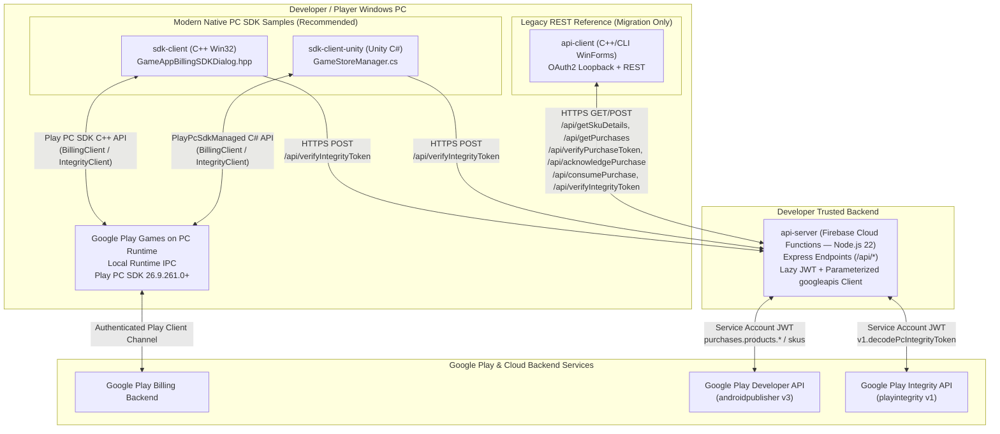

# Native PC SDK Sample — Overall System Design (`DESIGN.md`)

- **Repository**: `https://github.com/playgameservices/native-pc-sdk-sample/`
- **Target SDK**: Google Play Games PC SDK `26.9.261.0+`
- **Components**: `sdk-client` (C++ Win32), `sdk-client-unity` (Unity 6000 C#), `api-client` (Legacy REST Migration Reference), `api-server` (Firebase Cloud Functions Node.js 22 Verification Backend)
- **Last Updated**: 2026-11-19

---

## 1. System Overview

`native-pc-sdk-sample` is the official reference repository for Google Play Games on PC native Windows developers. It demonstrates:
1. **Modern Native PC SDK Integration (`sdk-client` & `sdk-client-unity`)**: How a native Windows C++ or Unity C# game communicates with the local **Google Play Games on PC client runtime** (`GooglePlayGamesServices.exe` local IPC) to initialize the SDK, query in-app product catalogs, check alternative billing programs, launch purchase flows, restore purchases, acknowledge/consume entitlements, and request Play Integrity tokens.
2. **Backend Token Verification (`api-server`)**: How a developer's trusted backend verifies purchase tokens (`androidpublisher` v3 REST API) and PC Play Integrity tokens (`playintegrity` v1 REST API) using a Google Cloud Service Account.
3. **Legacy REST-to-SDK Migration Reference (`api-client`)**: How legacy PC games that previously implemented OAuth2 browser sign-in + REST API calls (`api-client`) map each workflow step to the modern Native PC SDK (`sdk-client`).

---

## 2. End-to-End Architecture



---

## 3. Migration Mapping: `api-client` (Legacy REST) $\rightarrow$ `sdk-client` (C++) & `sdk-client-unity` (C#)

Developers migrating from `api-client/` to `sdk-client/` replace manual OAuth2 browser login, loopback HTTP listeners, and server-proxied catalog/checkout calls with direct local IPC calls via the Play PC SDK:

| Workflow Step | Legacy `api-client` (OAuth2 + REST) | Modern `sdk-client` (C++ SDK `26.9.261.0+`) | Modern `sdk-client-unity` (C# SDK `26.9.261.0+`) |
| :--- | :--- | :--- | :--- |
| **1. Initialization & Auth** | Manual browser OAuth2 login (`Google Login` $\rightarrow$ loopback `127.0.0.1:8080` listener $\rightarrow$ PKCE `S256` token exchange for `userAccessToken`) | `GooglePlayInitialize(continuation, GooglePlayInitializeParams{.package_name})` + `BillingClient(BillingClientParams{.enable_pending_purchases = true})` (Zero OAuth code needed; authenticated by Play Games client) | `PlayPcSdkFactory.Initialize(packageName).InitializeAsync()` + `PlayPcSdkFactory.CreateBillingClient(new BillingClientParams { EnablePendingPurchases = true })` |
| **2. Product Catalog Query** | `GET /api/getSkuDetails` with `userAccessToken`, `sku`, `ipAddress`, `languageCode` *(EAP-restricted REST endpoint)* | `BillingClient::QueryProductDetails(QueryProductDetailsParams, continuation)` *(local IPC; supports multi-SKU selection & `full_price_micros`)* | `BillingClient.QueryProductDetailsAsync(QueryProductDetailsParams)` |
| **3. Alternative Billing Check** | *Not supported in legacy REST* | `BillingClient::IsBillingProgramAvailable(IsBillingProgramAvailableParams, continuation)` | `BillingClient.IsBillingProgramAvailableAsync(IsBillingProgramAvailableParams)` |
| **4. Alternative Billing Reporting Token** | *Not supported in legacy REST* | `BillingClient::CreateBillingProgramReportingDetails(CreateBillingProgramReportingDetailsParams, continuation)` $\rightarrow$ returns `external_transaction_token` | `BillingClient.CreateBillingProgramReportingDetailsAsync(CreateBillingProgramReportingDetailsParams)` $\rightarrow$ returns `ReportingDetails` |
| **5. Purchase Checkout Flow** | Launch system browser with checkout URL returned from `getSkuDetails`, then query `Get Purchases` | `BillingClient::LaunchPurchaseFlow(LaunchPurchaseFlowParams{.offer_token}, continuation)` $\rightarrow$ renders native Play overlay & returns `ProductPurchaseDetails` directly | `BillingClient.LaunchPurchaseFlowAsync(LaunchPurchaseFlowParams)` $\rightarrow$ returns `LaunchPurchaseFlowResultValue` |
| **6. Restore Existing Purchases** | `GET /api/getPurchases?packageName=...&userAccessToken=...` *(EAP-restricted REST endpoint)* | `BillingClient::QueryPurchases(QueryPurchasesParams, continuation)` $\rightarrow$ returns `vector<ProductPurchaseDetails>` | `BillingClient.QueryPurchasesAsync(QueryPurchasesParams)` $\rightarrow$ returns `List<ProductPurchaseDetails>` |
| **7. Acknowledge Non-Consumable** | `POST /api/acknowledgePurchase` (Server REST API) | Client SDK `BillingClient::AcknowledgePurchase(AcknowledgePurchaseParams{.purchase_token}, continuation)` (or Server `/api/acknowledgePurchase` after token verification) | `BillingClient.AcknowledgePurchaseAsync(AcknowledgePurchaseParams)` |
| **8. Consume Consumable** | `POST /api/consumePurchase` (Server REST API) | Client SDK `BillingClient::ConsumePurchase(ConsumePurchaseParams{.purchase_token}, continuation)` (or Server `/api/consumePurchase` after token verification) | `BillingClient.ConsumePurchaseAsync(ConsumePurchaseParams)` |
| **9. Play Integrity Verification** | `POST /api/verifyIntegrityToken` | `IntegrityClient::PrepareIntegrityToken` $\rightarrow$ `IntegrityClient::RequestIntegrityToken` (with SHA-256 `request_hash`) $\rightarrow$ `POST /api/verifyIntegrityToken` | `IntegrityClient.PrepareIntegrityTokenAsync` $\rightarrow$ `IntegrityClient.RequestIntegrityTokenAsync` $\rightarrow$ `POST /api/verifyIntegrityToken` |

---

## 4. Component Design Details

### 4.1 `sdk-client/` (C++ Win32 Native PC SDK Sample)

#### Files & Responsibilities
- `GameApplication/GameApplication.cpp`: Win32 application entry point (`wWinMain`), OpenGL Teapot window, and button command handler (`IDR_BTN_BILLING_SDK`) that opens the modal `GameAppBillingSdkDialog`.
- `GameApplication/GameAppBillingSDKDialog.hpp`: Encapsulates all 11 interactive SDK operations inside the `IDD_SDK` dialog:
  1. `Initialize Billing SDK` (`kSdkInit`)
  2. `Query Product Details` (`kQueryProductDetails`)
  3. `IsBillingProgramAvailable` (`kIsBillingProgramAvailable`)
  4. `CreateBillingProgramReportingDetails` (`kCreateBillingProgramReportingDetails`)
  5. `Launch Purchase Flow` (`kLaunchPurchaseFlow`)
  6. `Query Purchases` (`kQueryPurchases`)
  7. `Acknowledge Purchase` (`kAcknowledgePurchase`)
  8. `Consume Purchase` (`kConsumePurchase`)
  9. `Prepare Integrity Token` (`kPrepareIntegrityToken`)
  10. `Request Integrity Token` (`kRequestIntegrityToken`)
  11. `Verify Integrity Token` (`kVerifyIntegrityToken`)
- `GameApplication/GameAppGenericClasses.hpp`: Thread-safe `GameLogging`, UTF-8/UTF-16 string conversion, `ResolveManifestPath()` (`manifest.local.xml` $\rightarrow$ `<exe_dir>\manifest.local.xml` $\rightarrow$ `<exe_dir>\manifest.xml` $\rightarrow$ `manifest.xml`), null-safe `tinyxml2` XML parsing, comma-separated `<SKU>` list splitting (`manifest.App.skuList`), and `GameBillingApis.json` metadata loader.
- `GameApplication/manifest.xml` & gitignored `GameApplication/manifest.local.xml`: Runtime configuration defining `<PackageName>`, `<IsDeveloperMode>`, `<SKU>` (single or comma-separated list), `<CloudProjectNumber>`, and `<BackendBaseUrl>`.

#### Key Architectural Invariants in `sdk-client/`
1. **SDK `26.9.261.0+` Initialization & Error Handling**:
   - Passes `GooglePlayInitializeParams{.package_name = manifest.App.PackageName}` to `GooglePlayInitialize`.
   - Switches on `initialize_result.code()` (of type `InitializationError`):
     - `kOk (0)`: Logs `InitializeResultValue::environment` (`kWindows` / `kAndroid`) and `form_factor` (`kDesktop` / `kMobile`), then constructs `BillingClient` and `IntegrityClient`.
     - `kActionRequiredShutdownClientProcess (2)`: Displays a notice that Google Play Games is restarting the game under the Play runtime and calls `PostQuitMessage(0)` to exit immediately.
     - `kSdkRuntimeUpdateRequired (3)`, `kSdkRuntimeUnavailable (4)`, `kSdkRuntimeNotInstalled (5)`, `kError (1)`: Displays actionable diagnostic messages without crashing.
2. **RAII & Thread-Safe Client Lifetimes**:
   - SDK clients and cached result objects are managed via `std::shared_ptr` / `std::optional` (`std::shared_ptr<BillingClient> mBillingClient`, `std::shared_ptr<IntegrityClient> mIntegrityClient`, `std::optional<PrepareIntegrityTokenResultValue> mPrepareIntegrityTokenResValue`, `std::optional<RequestIntegrityTokenResultValue> mRequestIntegrityTokenResValue`) so async background continuations never dereference destroyed pointers if the dialog closes early.
   - `GameAppBillingSdkDialog` is stack-allocated when `IDR_BTN_BILLING_SDK` is clicked.
3. **Non-Blocking UI Continuation Dispatch**:
   - Button handlers run continuations on a background worker thread so `DialogProc` continues pumping Win32 messages while waiting for Play overlay interaction (`LaunchPurchaseFlow`), posting results back to the UI thread via `PostMessage(m_hWnd, WM_APP_SDK_RESULT, ...)`.
4. **Cryptographic Play Integrity `request_hash`**:
   - Computes a SHA-256 hex digest using Windows CNG (`BCryptHash` + `BCryptGenRandom` with `BCRYPT_SHA256_ALGORITHM`) over a canonical request payload + CSPRNG nonce.
5. **Debug & Release `vcpkg` Build Parity**:
   - `GameApplication.vcxproj` and `GameEngine.vcxproj` enable MSBuild `vcpkg` manifest properties (`$(SolutionDir)vcpkg_installed`), automatically select `restclient-cppd.lib` / `tinyxml2d.lib` vs Release `.lib`s via `ResolveVcpkgDebugLibs`, and conditionally copy matching `Debug` vs `Release` runtime DLLs.

---

### 4.2 `sdk-client-unity/` (Unity 6000 C# Sample)

#### Files & Responsibilities
- `Assets/Scripts/GameStoreManager.cs`: MonoBehaviour controller managing the Unity UI buttons and calling `PlayPcSdkManaged.Billing` and `PlayPcSdkManaged.Integrity` async APIs.
- **Zero `.unity` Scene File Mutation (Dynamic Button Cloning)**: `Assets/Scenes/SampleScene.unity` is kept 100% untouched so Unity scene YAML serialization is never corrupted. For operations beyond the 4 original scene buttons (`_initializeButton`, `_queryButton`, `_purchaseButton`, `_integrityButton`), `GameStoreManager.Start()` dynamically clones an existing button in the parent layout container and arranges all 11 operations in the exact `sdk-client` sequence:
  1. `Initialize Billing SDK` (`GooglePlayInitialization.InitializeAsync` + `PlayPcSdkFactory.CreateBillingClient` + `PlayPcSdkFactory.CreateIntegrityClient`)
  2. `Query Product Details` (`_billingClient.QueryProductDetailsAsync(QueryProductDetailsParams)`)
  3. `IsBillingProgramAvailable` (`_billingClient.IsBillingProgramAvailableAsync(IsBillingProgramAvailableParams)`)
  4. `CreateBillingProgramReportingDetails` (`_billingClient.CreateBillingProgramReportingDetailsAsync(CreateBillingProgramReportingDetailsParams)` $\rightarrow$ logs `Value.ReportingDetails`)
  5. `Launch Purchase Flow` (`_billingClient.LaunchPurchaseFlowAsync(LaunchPurchaseFlowParams)`)
  6. `Query Purchases` (`_billingClient.QueryPurchasesAsync()` $\rightarrow$ logs `Value.ProductPurchaseDetails` and caches unacknowledged/unconsumed tokens)
  7. `Acknowledge Purchase` (`_billingClient.AcknowledgePurchaseAsync(AcknowledgePurchaseParams)`)
  8. `Consume Purchase` (`_billingClient.ConsumePurchaseAsync(ConsumePurchaseParams)`)
  9. `Prepare Integrity Token` (`_integrityClient.PrepareIntegrityTokenAsync`)
  10. `Request Integrity Token` (`_integrityClient.RequestIntegrityTokenAsync` with SHA-256 `RequestHash`)
  11. `Verify Integrity Token` (`POST /api/verifyIntegrityToken` via `UnityWebRequest`)

---

### 4.3 `api-client/` (Legacy REST Migration Reference)

#### Purpose & Scope
- Retained specifically as a **side-by-side "Before" reference** for developers migrating from legacy OAuth2 + Web REST billing to `sdk-client/`.
- Cleaned up to remove dead `#ifdef __ANDROID__` NDK files and stale `IDR_JSON3` (`userToken.json`) resource entries in UTF-16LE `GameApplication.rc`, while fixing security and runtime defects in the Windows C++/CLI implementation:
  1. **Fresh Per-Login RFC 7636 PKCE (`S256`) & `state` CSRF Validation**: `AppSettingsFiles::RegenerateOAuthSecurityParams()` mints fresh CSPRNG `state` and PKCE `code_verifier`/`code_challenge` values on every `Google Login` click in `GameHelper.cpp` and validates them in `DevServer.cpp`.
  2. **Strict Loopback Listener Binding**: Binds `HttpListener` strictly to `http://127.0.0.1:8080/` with open-proxy routes removed.
  3. **Gitignored `.local` Overrides & `<BackendBaseUrl>` Rewriting**: `AppSettingsFiles` resolves `manifest.local.xml` and `AppConfig.local.json` first (copied to `$(OutDir)manifest.xml` and `$(OutDir)AppConfig.json` by MSBuild `CopyLocalConfigOverrides`) and rewrites loaded `GameApis.json` URLs when `<BackendBaseUrl>` is set.
  4. **Purchase Token & Parameter-Table Synchronization**: `GetPurchasesDetails()` syncs `mSku` with the purchased `productId`; `GetValidatePurchase()`, `GetAcknowledgePurchase()`, and `PostConsumePurchase()` honor manual `token` / `productId` edits in `tableParameters` and surface HTTP error bodies in `txtResult`; `VerifyIntegrityToken` leaves `token` clean for pasting a Play Integrity token rather than prefilling the OAuth2 access token.

---

### 4.4 `api-server/` (Firebase Cloud Functions Verification Backend)

#### Backend Structure
```text
api-server/
├── .firebaserc
├── firebase.json             # Hosting (/api/** -> main) + Node.js 22 Functions + cross-platform predeploy
├── public/
│   └── index.html
├── README.md
└── functions/
    ├── .env                  # Gitignored local/deploy secrets (SA_EMAIL, SA_KEY, PLAY_PACKAGE_NAME)
    ├── .eslintrc.yml
    ├── package.json          # engines.node = "22", googleapis ^144, firebase-functions ^5.1, express ^4.21
    ├── package-lock.json     # Synchronized lockfileVersion 3 for Cloud Build `npm ci`
    ├── tsconfig.json
    └── src/
        ├── billing.ts        # Purchase & SubscriptionPurchase domain models
        ├── config.ts         # Environment-backed config with generic fallback placeholders
        ├── index.ts          # Express HTTP handler (`main`) & Pub/Sub RTDN handler (`rtdnListener`)
        ├── notifications.ts  # Real-Time Developer Notification (RTDN) types
        └── playApiClient.ts  # Lazy Service Account JWT init + parameterized androidpublisher_v3 & playintegrity_v1 calls
```

#### Architectural & Security Invariants in `api-server/`
1. **Node.js 22 Runtime & Lazy Service Account Initialization**:
   - Targets `"runtime": "nodejs22"` (following Cloud Functions' 2026-10-30 decommission of `nodejs20`) and exports cleanly scoped `main` (HTTP `/api/*`) and `rtdnListener` (Pub/Sub) functions.
   - `playApiClient.ts` initializes `google.auth.JWT` and `google.androidpublisher` lazily inside `getPlayClients()` on first request so `process.env.SA_EMAIL`, `process.env.SA_KEY`, and `process.env.PLAY_PACKAGE_NAME` from `functions/.env` (or Cloud Secret Manager) are always loaded cleanly during both Firebase CLI discovery and runtime execution.
2. **Token-Based Client-to-Server Contract & Package Isolation**:
   - Sample clients (`sdk-client`, `sdk-client-unity`, `api-client`) pass Google-issued tokens (`userAccessToken`, `purchaseToken`, or `integrity_token`) without requiring Firebase Auth.
   - `resolvePackageName()` enforces strict single-package isolation whenever `PLAY_PACKAGE_NAME` is configured, rejecting cross-package abuse with `Unauthorized packageName`.
3. **Zero Raw URL Interpolation (SSRF Prevention)**:
   - All calls to Google APIs use parameterized `googleapis` SDK methods (`purchases.products.get`, `.acknowledge`, `.consume`, `purchases.subscriptions.get`) or `new URL()` + `encodeURIComponent()` + `URLSearchParams` with strict regex validation (`PACKAGE_NAME_REGEX`, `PRODUCT_ID_REGEX`, `SAFE_TOKEN_REGEX`).

---

## 5. Local Configuration Overrides & Operational Requirements

### 5.1 Gitignored `.local` & `functions/.env` Pipeline
To prevent accidental secret or test-identifier commits while supporting zero-friction Visual Studio and Firebase builds:
1. Root `.gitignore` excludes `**/manifest.local.xml`, `**/AppConfig.local.json`, and `api-server/functions/.env*`.
2. **Why MSBuild Copies `manifest.local.xml` $\rightarrow$ `$(OutDir)manifest.xml`**: The Google Play Games on PC runtime (`GooglePlayGamesServices.exe`) verifies caller identity by inspecting a file literally named `manifest.xml` next to the calling `.exe` (`x64\Debug\manifest.xml`). Copying `manifest.local.xml` to `$(OutDir)manifest.xml` satisfies the runtime's caller-identity check while leaving tracked `GameApplication\manifest.xml` untouched.

### 5.2 Windows 64-Bit Developer Mode Registry Requirement (`EarlyAccessPartnerGuid`)
When testing unsigned Visual Studio builds locally outside the Google Play Games client using Developer Mode:
- 64-bit `GooglePlayGamesServices.exe` reads `EarlyAccessPartnerGuid` from the **64-bit** registry view:
  `HKLM\Software\Google\Play Games Services\EarlyAccessPartnerGuid` (`/reg:64`).
- Keys written only under 32-bit `HKLM\SOFTWARE\WOW6432Node\Google\Play Games Services` are not visible to the 64-bit service; copy the value to `/reg:64` and restart the `GooglePlayGamesServices-<version>` Windows service.

### 5.3 Play Integrity `<CloudProjectNumber>` & Legacy EAP Visibility Alignment
1. **Play Integrity Project Matching**: `PrepareIntegrityToken(cloud_project_number)` encrypts the PC integrity token specifically for that Google Cloud project. `<CloudProjectNumber>` in `manifest.local.xml` (or Unity Inspector) **must** match the numeric project number of the Service Account (`SA_EMAIL`) configured in `api-server`.
2. **Legacy REST EAP Visibility (`api-client` Only)**: While `verifyPurchaseToken`, `acknowledgePurchase`, `consumePurchase`, and `verifyIntegrityToken` are public GA APIs, the two legacy `api-client` endpoints (`SkuDetailsService.List` at `/skus` and `ProductPurchasesService.List` at `/purchases/products`) require the calling Service Account's Cloud project to hold Early Access Partner visibility on `androidpublisher.googleapis.com` (returning `404 Method not found.` otherwise) and require signing into `Google Login` with a non-developer license-tester Google Account.

### 5.4 Bundled Developer Setup Agent Skill (`.agents/skills/setup-native-pc-sdk-sample/`)
Because tracked templates contain placeholders only, the repository ships an open-standard (`agentskills.io`) developer onboarding skill under `.agents/skills/setup-native-pc-sdk-sample/`:
- **`SKILL.md`**: Step-by-step interactive workflow covering preflight checks, track-specific intake (`sdk-client`, `sdk-client-unity`, `api-client`, `api-server`), optional `gcloud` API/Service Account provisioning, Play Console permission setup, MSBuild/`vcpkg`/Firebase deployment gates, and zero-secret guardrails.
- **`scripts/preflight.mjs`**: Zero-dependency Node.js checker reporting toolchains, `play_pc_sdk` placement, `vcpkg_installed`, gitignored override status, and Windows 64-bit vs `WOW6432Node` `EarlyAccessPartnerGuid` status without printing secrets or GUIDs.
- **`scripts/configure_local.mjs`**: Deterministic BOM-free UTF-8 override generator supporting both Google Cloud Console's `{"installed": {...}}` Desktop OAuth JSON download and flat `AppConfig.json`, enforcing `git check-ignore` before writing any file.
- **`references/troubleshooting.md`**: Symptom-to-fix lookup table for verified Windows build, registry, Play Billing, Play Integrity, Firebase Node.js 22, and legacy OAuth failure modes.
