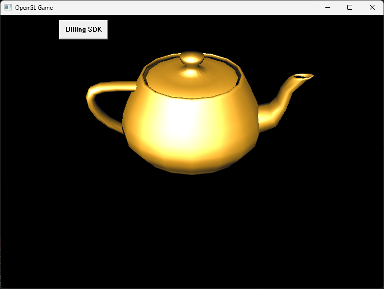
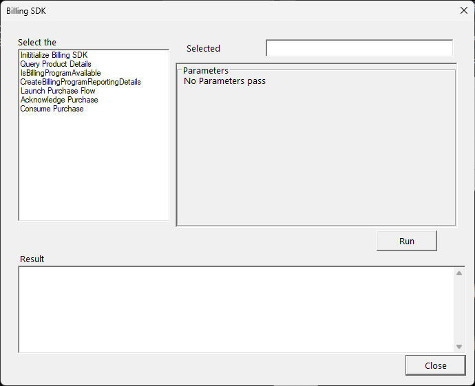

# Native C++ PC SDK Sample (`sdk-client`)

This project demonstrates how to integrate the **[Google Play Games on PC Native C++ SDK (`26.9.261.0+`)](https://developer.android.com/games/playgames/native-pc/)** into a native Windows C++ game, covering:
- **SDK Initialization** (`GooglePlayInitialize` + `BillingClient` + `IntegrityClient`)
- **Play Billing**:
  1. `Initialize Billing SDK`
  2. `Query Product Details` (`QueryProductDetails`, supporting comma-separated multi-SKU dropdowns and `full_price_micros` strike-through offers)
  3. `IsBillingProgramAvailable`
  4. `CreateBillingProgramReportingDetails` (`external_transaction_token`)
  5. `Launch Purchase Flow` (`LaunchPurchaseFlow`, handling `PURCHASED` vs `PENDING`)
  6. `Query Purchases` (`QueryPurchases` for startup/foreground purchase restoration)
  7. `Acknowledge Purchase` (`AcknowledgePurchase`)
  8. `Consume Purchase` (`ConsumePurchase`)
- **Play Integrity**:
  9. `Prepare Integrity Token` (`PrepareIntegrityToken`)
  10. `Request Integrity Token` (`RequestIntegrityToken` with Windows CNG SHA-256 `request_hash`)
  11. `Verify Integrity Token` (Server-side verification via [`api-server`](../api-server))

> **Migrating from Legacy REST APIs?** Compare this project with [`api-client/`](../api-client/) and see the side-by-side migration mapping in [`docs/DESIGN.md`](../docs/DESIGN.md#3-migration-mapping-api-client-legacy-rest-rightarrow-sdk-client-c--sdk-client-unity-c). Notice that **no OAuth2 `client_id` / `client_secret` or local HTTP callback listener is used** in `sdk-client`—authentication is handled automatically by the local Google Play Games on PC client runtime.

---

## Prerequisites & Windows Setup

1. **Install Third-Party C++ Libraries via [vcpkg](https://vcpkg.io/en/getting-started.html)**:
   Run inside `sdk-client/` (creates `sdk-client/vcpkg_installed/` for both `Debug` and `Release` builds):
   ```powershell
   vcpkg install
   ```

2. **Download the Google Play Games PC SDK (`26.9.261.0` or newer)**:
   - Download the C++ SDK archive from [Play Games PC SDK Downloads](https://developer.android.com/games/playgames/native-pc/downloads).
   - Extract it into `sdk-client/play_pc_sdk/` (using the version-independent folder name `play_pc_sdk` so `play_pc_sdk/includes/` and `play_pc_sdk/imports/` exist next to `Teapot.sln`).

3. **Install [Google Play Games on PC](https://play.google.com/googleplaygames)** and sign in with a license-tester Google Account.
   - **Local Developer Mode (64-Bit Registry Check)**: When launching an unsigned Visual Studio build directly outside the Google Play Games client, ensure your `EarlyAccessPartnerGuid` (if enrolled in local developer mode) is present in the **64-bit** Windows Registry view:
     ```powershell
     reg query "HKLM\Software\Google\Play Games Services" /v EarlyAccessPartnerGuid /reg:64
     ```
     *(64-bit `GooglePlayGamesServices.exe` ignores `HKLM\SOFTWARE\WOW6432Node\Google\Play Games Services`. Restart the `GooglePlayGamesServices-<version>` Windows service after updating the registry.)*

4. **Create Gitignored `GameApplication/manifest.local.xml`** *(Recommended — keeps tracked [`GameApplication/manifest.xml`](GameApplication/manifest.xml) clean)*:
   ```xml
   <?xml version="1.0" encoding="utf-8"?>
   <Manifest version="1">
     <Application>
       <PackageName>com.example.yourgame</PackageName>
       <IsDeveloperMode>true</IsDeveloperMode>
       <SKU>your_consumable_sku,your_non_consumable_sku</SKU>
       <CloudProjectNumber>123456789012</CloudProjectNumber>
       <BackendBaseUrl>https://your-project.web.app</BackendBaseUrl>
     </Application>
   </Manifest>
   ```
   - **Automatic Build Output Copy**: On build, MSBuild (`CopyLocalManifestOverride`) automatically copies `manifest.local.xml` to `$(OutDir)manifest.xml` next to `GameApplication.exe` (required by `GooglePlayGamesServices.exe` caller-identity verification).
   - **Multi-SKU Support**: Separate multiple active In-App Product IDs with commas in `<SKU>` to populate all of them into the `Query Product Details` SKU dropdown (e.g., one consumable SKU for `Consume Purchase` and one single-quantity SKU for `Acknowledge Purchase`).
   - **Play Integrity Project Alignment**: `<CloudProjectNumber>` **must** match the numeric Google Cloud project number of the Service Account configured in [`api-server`](../api-server) (`SA_EMAIL`), as Play Integrity encrypts tokens specifically for that Cloud project.
   - **Backend Bearer Authentication (`API_AUTH_TOKEN`)**: Because [`api-server`](../api-server) requires a Firebase Auth ID token on `/api/verifyIntegrityToken`, set the `API_AUTH_TOKEN` environment variable (preferred) or add `<ApiAuthToken>` in gitignored `manifest.local.xml` before running step 11 (`Verify Integrity Token`).

---

## Building and Running

1. Open [`Teapot.sln`](Teapot.sln) in Microsoft Visual Studio (`Debug|x64` or `Release|x64`).
2. Press **F5** to build and run (`manifest.xml`, `play_pc_sdk.dll`, and matching `Debug`/`Release` `vcpkg` DLLs are automatically copied next to `GameApplication.exe`).
3. On the OpenGL Teapot window, click **Billing SDK** to open the interactive SDK panel:
   
   
4. Run the operations in sequence:
   1. **Initialize Billing SDK** — Connects to the Google Play Games runtime and creates `BillingClient` and `IntegrityClient`. (If launched outside Google Play Games without developer mode, `kActionRequiredShutdownClientProcess` cleanly exits so Google Play Games can relaunch the game.)
   2. **Query Product Details** — Queries localized pricing and offer tokens for the selected SKU in `<SKU>`.
   3. **IsBillingProgramAvailable** / **CreateBillingProgramReportingDetails** — Checks alternative billing program eligibility and retrieves `external_transaction_token`.
   4. **Launch Purchase Flow** — Opens the Google Play purchase overlay without blocking the Win32 UI thread *(note: Developer Mode test purchases auto-refund after ~3 minutes if not acknowledged/consumed)*.
   5. **Query Purchases** — Restores existing unacknowledged/unconsumed purchases and populates them into the Acknowledge/Consume selectors.
   6. **Acknowledge Purchase** / **Consume Purchase** — Acknowledges non-consumable entitlements or consumes repeatable items.
   7. **Prepare / Request / Verify Integrity Token** — Warms up Play Integrity (`<CloudProjectNumber>`), generates a cryptographic SHA-256 `request_hash`, requests a PC integrity token, and verifies the verdict via `api-server`.
